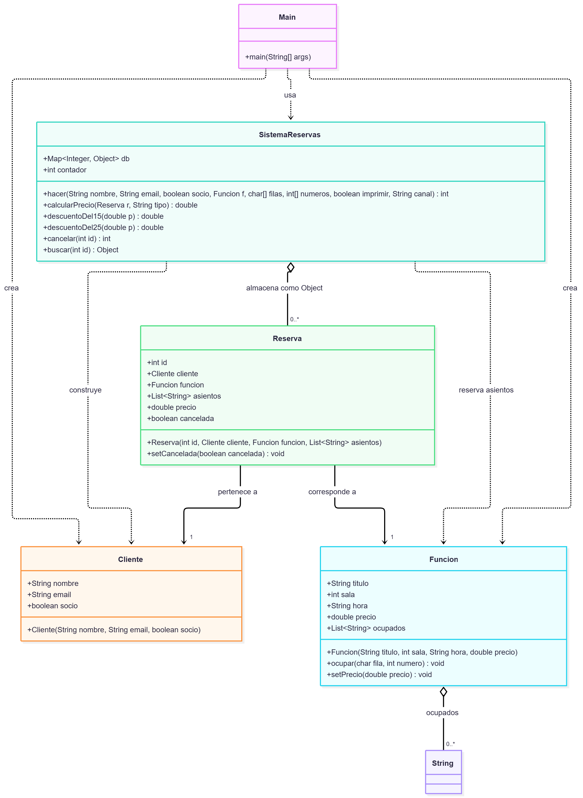
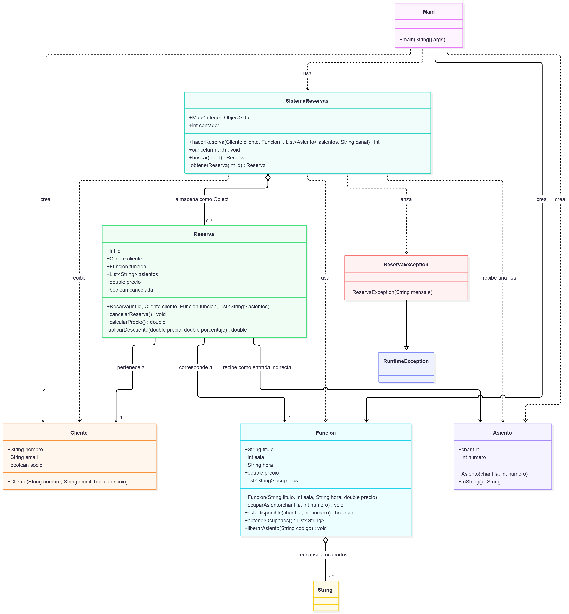

# Sistema de reservas de cine

Proyecto académico de un sistema sencillo para gestionar reservas de asientos
en una función de cine. El repositorio muestra el código **antes** y
**después** de aplicar técnicas de refactorización.

## Contenido del proyecto

| Carpeta | Descripción |
|---|---|
| [`AntesRefactorizacion/`](./AntesRefactorizacion/) | Versión original, con problemas de diseño y código duplicado. |
| [`DespuesRefactorizacion/`](./DespuesRefactorizacion/) | Versión refactorizada, con responsabilidades más claras y mejores abstracciones. |
| [`diagramas/`](./diagramas/) | Diagramas de clases de ambas versiones. |

## Comparación

### Antes de la refactorización

La versión original concentra gran parte de la lógica en `SistemaReservas`.
Entre los problemas identificados se encuentran:

- Parámetros innecesarios y datos relacionados separados.
- Arreglos paralelos para representar los asientos.
- Códigos numéricos para comunicar errores.
- Estado interno expuesto directamente.
- Métodos duplicados y nombres poco descriptivos.
- Ocupación parcial de asientos cuando una reserva falla.

### Después de la refactorización

La versión mejorada aplica técnicas de refactorización para hacer el código
más legible, mantenible y seguro:

- Se introducen las clases `Asiento` y `ReservaException`.
- Se agrupan los datos relacionados en objetos y listas.
- Se reemplazan los códigos de error por excepciones.
- Se encapsula el acceso a los asientos ocupados.
- Se eliminan parámetros y métodos innecesarios.
- Se mejora la claridad de los nombres y de las responsabilidades.

## Diagramas de clases

### Antes de la refactorización

### Después de la refactorización

## Ejecución

Cada versión puede compilarse y ejecutarse desde su propia carpeta:

La ejecución crea una reserva válida, intenta crear una reserva con un asiento
ocupado y muestra el comportamiento de la cancelación de reservas.
